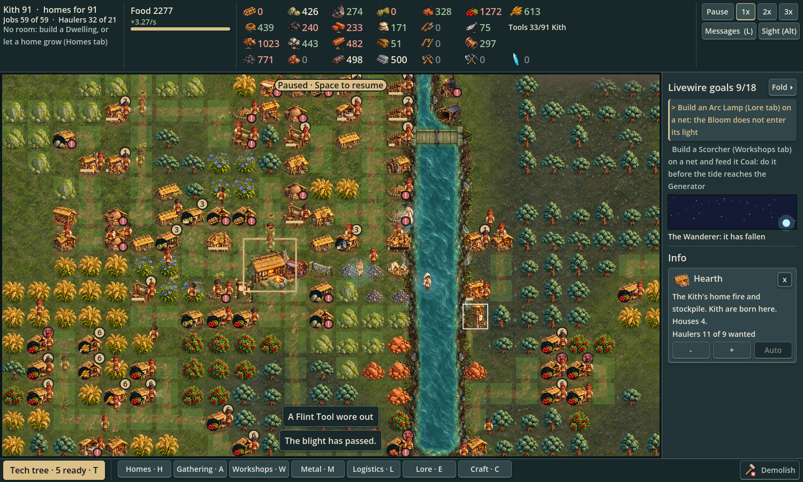
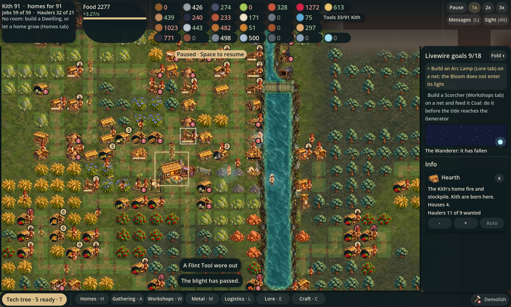
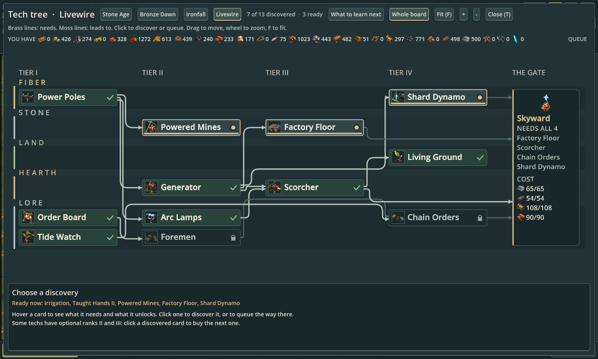
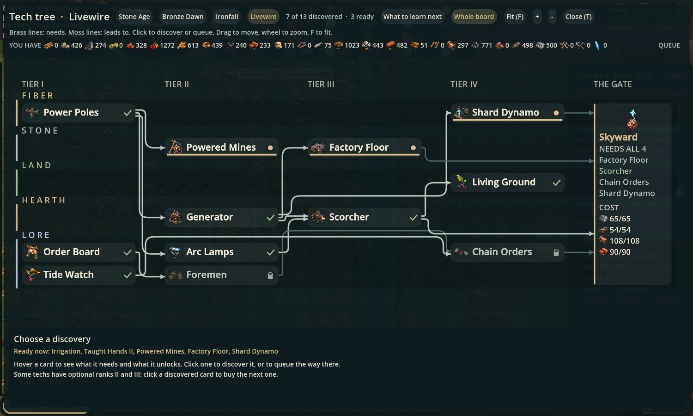
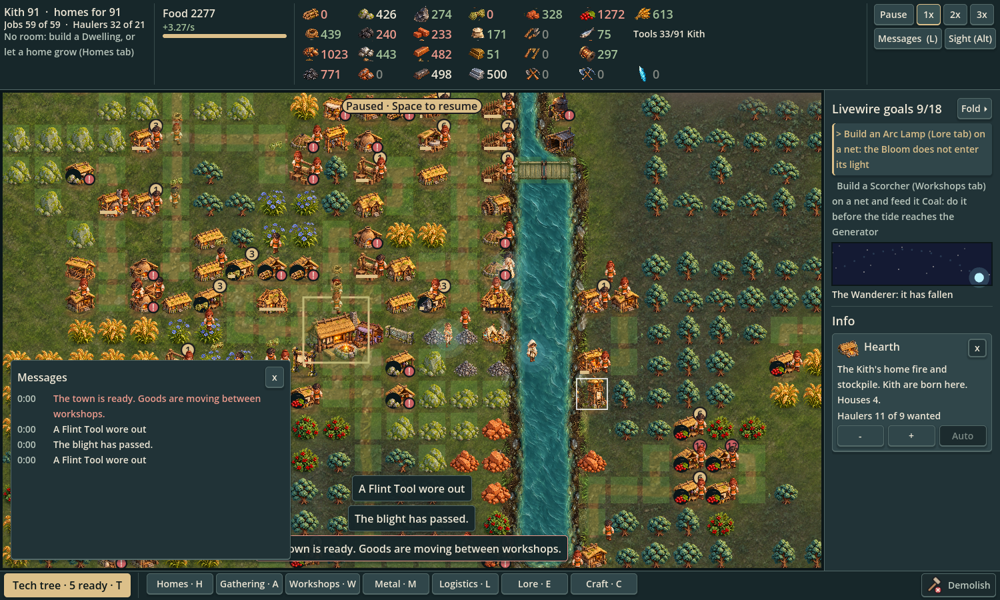
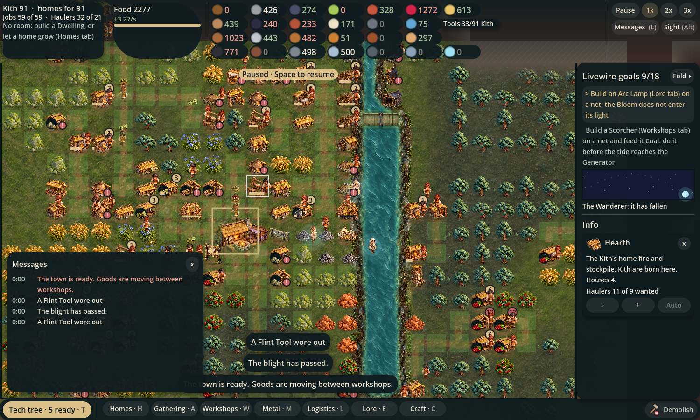
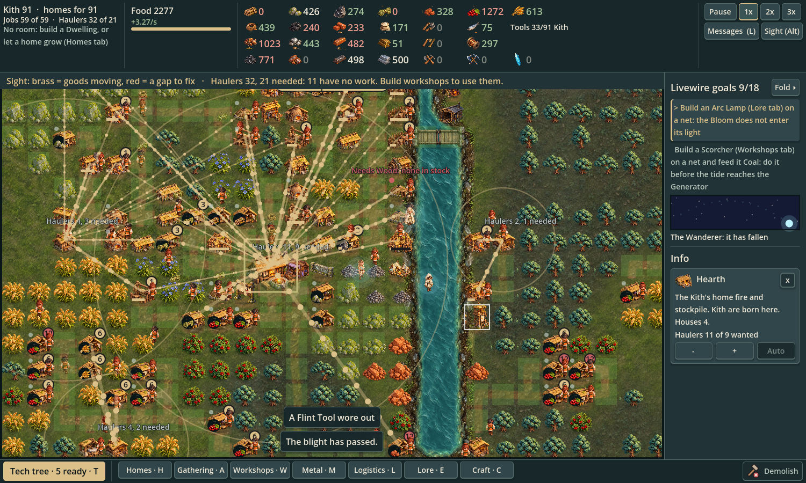
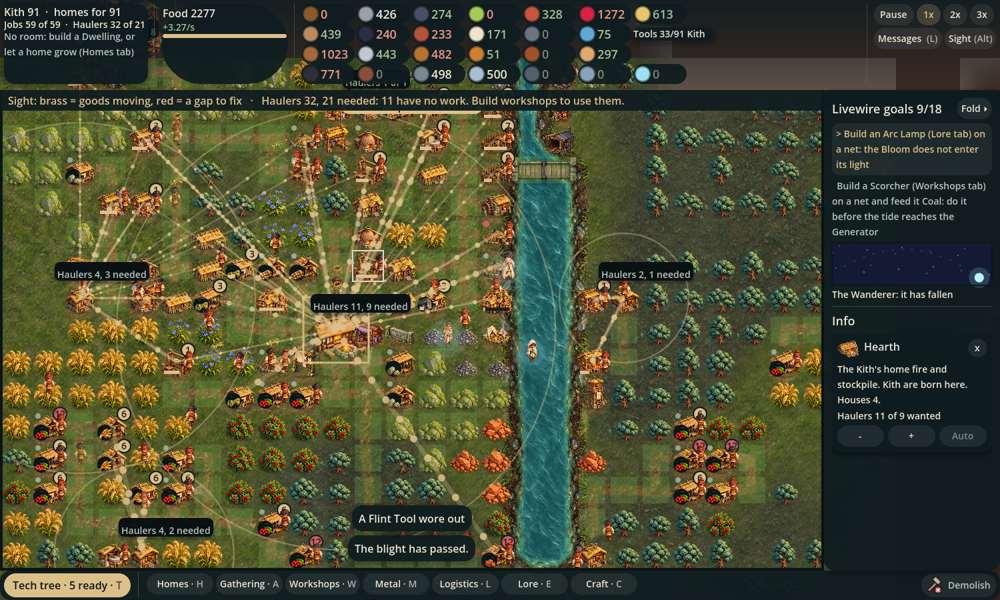

# Glass interface review

Owner direction: Jon's Glass selection, 2026-10-24. Baseline: `3322bf0` (Sight #146). Native Godot 4.7.2 captures, 1500 × 900, same loaded Livewire tide town, camera, simulation ticks and controls. These are game screenshots, with no paintover or generated art. No new font or production asset.

## Paired views

| View | Before | Glass |
| --- | --- | --- |
| Top bar + building panel |  |  |
| Whole tech tree |  |  |
| Toast + message log |  |  |
| Sight, Livewire town |  |  |

## Skin contract

`ui.gd` centralizes the Glass fills, radii, shadow, key opacity and Sight flow opacity. Existing semantic colours and callers remain. Panels use dark `0f1c1f` at 240/255 alpha (94.1%); cards use 6% white, buttons 7% white / 15% hover and 20% brass selected, with the existing solid brass primary action. The map frame retains its geometry with its top stroke hidden. Top bar fades from 88% to clear, with protected readout backings inside their original rectangles. Goods retain their original 24 px icon slot, painted as round colour swatches. Key text retains Button.text and its measurement, with the suffix drawn at 70% opacity.

Readability takes priority over the suggested 65% panel opacity. Over pure white, the protected panel gives ivory 12.07:1 and secondary text 8.50:1; a 6% white card over it gives 10.08:1 / 7.09:1. The old opaque panel gives 10.69:1 / 7.53:1 (old cards are lighter still). Pure white bounds snow, sand and Bloom ground. Status constants BAD, GOOD, SHORT, ACTION and KITH are unchanged. Dark action text remains on solid brass. Sight chips use a separate `081013` / 98% backing: red `Ui.BAD` is 4.70:1 over white, exceeding the former dark outline (4.36:1). Sight keeps red gaps, brass delivery lines and dim resting/paused dots; chips paint after all lines and share an eight-label, padding-aware collision budget, including hover.

## Geometry evidence

The fixture records every visible Control rectangle, including the original text-bearing controls. Each paired JSON is byte-for-byte equivalent after parsing; no control was added, removed, resized or repositioned by the skin.

| View | Visible controls compared | Changed rectangles |
| --- | ---: | ---: |
| building | 237 | 0 |
| tech | 353 | 0 |
| messages | 258 | 0 |
| sight | 239 | 0 |

No gameplay, save, data, tests, font or CI configuration changes. `sight.gd` edits are confined to drawing, chip bounds and visual label selection; gathering and meaning are untouched. Message log inherits the shared panel/button skin. Trade rows keep their existing margins and receive card surfaces.

## Reproduce

Run with a display:

```sh
/Applications/Godot.app/Contents/MacOS/Godot --path . -s docs/art/glass-look/capture.gd -- /absolute/output/directory
```

The review fixture reuses `/tmp/solace-glass-fixture.run` if present; remove that file to build the current `livewire_tide` developer start afresh. It advances the loaded town 90 seconds to rebuild transient delivery history, then pauses simulation for the captures while allowing normal layout and drawing. Cursor-dependent hover info is cleared so pointer movement cannot change the paired text wrapping. The baseline uses the same fixture copied into a detached checkout of `3322bf0`. The docs directory is excluded from production imports, matching other art-review directories.

Local validation: Godot import; strict editor warnings; GDScript lint/format; scripted play-through to Bronze Dawn; 20-minute layout pass (1,133 HUD checks, zero problems and zero scale changes); menu/save/load and play-log passes. The full local logic suite passes. Exact-head CI is tracked in the PR.
