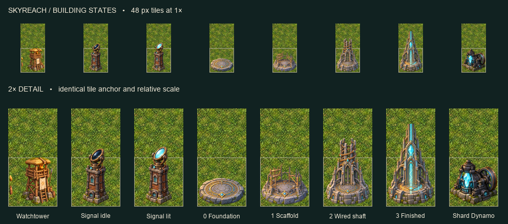

# Skyreach buildings

Six transparent built-in ImageGen originals in `art/rendered/`, with Godot 4.7.2 imports. [Full prompts, references, source hashes and draw regions](spec.json). All input imagery is fictional Solace art or a preceding sprite from this group.

The native comparison composites the actual PNGs on existing meadow art at one image pixel per game pixel in the upper row. The lower row doubles the view. Outlines mark the occupied cell. The lit Signal Tower preserves the idle body's scale and bottom anchor. The faint beam adds headroom. The Skyreach keeps the round foundation and front diamond across the four stages. Only stage 3 lights the ring and has a shaft intended to continue out of frame.

## Wiring reference

Each logical footprint is 1×1. Source regions in `spec.json` use `[x, y, width, height]`. Draw at the indicated size for a 48 px tile, bottom center two pixels above the cell's bottom edge. Scale the destination with zoom. Use the same ground anchor for either Signal Tower state and all Skyreach stages. Keep the 1×1 selection footprint when a shaft overlaps the tile above. The comparison uses the intended overlay extents. Claude owns runtime mapping and review.
