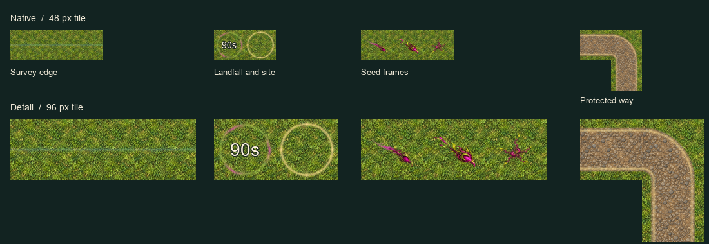

# Skyreach map marks

Six transparent PNGs in `art/rendered/`, with Godot 4.7.2 imports. [Raster recipes, seed prompts, references, frame regions and hashes](spec.json). The rings and tileable strokes were drawn as original analytic raster art so their clear centers and edge joins are controlled exactly. The three seed frames were painted in built-in ImageGen using Solace's Bloom texture and packed into one atlas.

The comparison uses one image pixel per game pixel in the upper row. The lower row enlarges the marks. The number is a 14 px sample overlay. The road fixture composites an existing cobble texture so the shoulders and corner joins can be inspected together.

| Asset | Draw guidance |
| --- | --- |
| `landfall_mark` | Draw the full 192×192 texture over one tile. The inner disc has zero alpha. Center the code-drawn countdown there. |
| `seed_fall` | Three 192×192 frames left to right. Draw each to one tile or smaller. The first two are descent and near-impact, angled from upper left to lower right. Center the third over the landing cell. |
| `sky_sector_edge` | Repeat along X and rotate to the surveyed bearing. The line is centered in a square transparent canvas. Preserve its low alpha and narrow width when extending it along a sector. |
| `skyreach_site_ring` | Center the full square over the site cell from discovery until construction. |
| `skyreach_way` and `skyreach_way_corner` | Full square straight (left/right) and corner (left/down) pieces. Rotate for other connections. The paired gold lines sit on the road shoulders. The interior stays transparent. |

Claude owns the map hooks and timing in `scripts/sky_marks.gd`.
