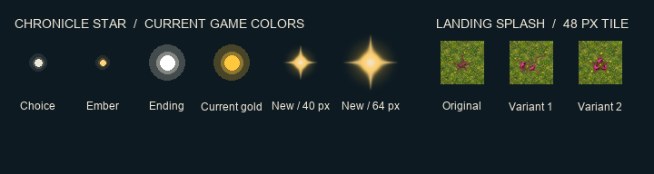

# Chronicle gold star and seed splashes

Three transparent PNGs in `art/rendered/`, with Godot 4.7.2 imports. [Raster recipe, full prompts, source references and hashes](spec.json).

- `chronicle_star_gold` is a 64×64 original raster glint using the existing `StarButton` palette and gold glow. The comparison places it beside the current star family on the Chronicle sky color, at the 40 px button size and at 64 px.
- `seed_fall_splash_1` and `seed_fall_splash_2` are 192×192 alternatives for the third cell of the [seed fall atlas](https://github.com/heezus/solace/pull/191). Built-in ImageGen painted the split-shell and three-petal impacts from the primary splash reference. Center either whole texture over the same landing tile. All three are shown at 48 px.

The star is a standalone texture. Claude owns its Chronicle hook and the choice of impact variant.
