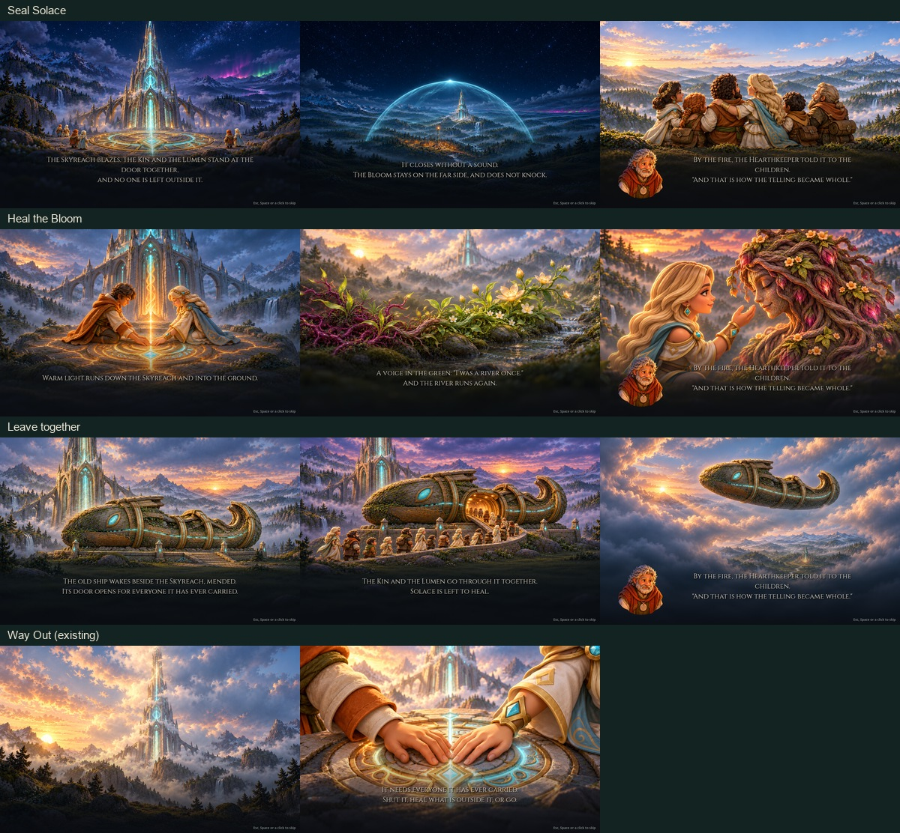

# Skyreach true-ending stills

Nine opaque, text-free 1586×992 PNGs in `art/rendered/cutscenes/`, with Godot 4.7.2 imports. [Full prompts, fictional project references, source sizes, hashes and canvas preparation](spec.json). All paintings used built-in ImageGen. Sources that differed from the requested canvas were center-fit to 1586×992.

| Sequence and exact stems | Native player comparison |
| --- | --- |
| Seal Solace · `seal_end_1`–`seal_end_3` | [1280×800](seal_end-1280.jpg) · [1600×900](seal_end-1600.jpg) |
| Heal the Bloom · `heal_end_1`–`heal_end_3` | [1280×800](heal_end-1280.jpg) · [1600×900](heal_end-1600.jpg) |
| Leave together · `leave_end_1`–`leave_end_3` | [1280×800](leave_end-1280.jpg) · [1600×900](leave_end-1600.jpg) |
| Existing Way Out | [1280×800](way_out-1280.jpg) · [1600×900](way_out-1600.jpg) |

Captures use the current Godot cutscene player late in its push-in, with the existing captions and Hearthkeeper overlay. Each frame in the linked strips is one player pixel per image pixel. The dome's closing point, Sela's face and hand, the boarding line and the ascending hull all remain clear at both sizes. Some spire tips and peripheral roots extend past the crop by design. The captions and portrait are drawn by the player.
