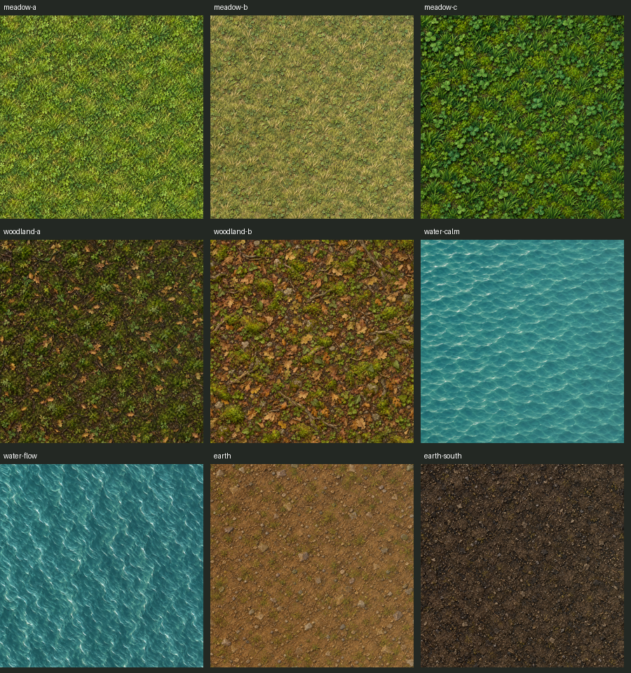

# Terrain kit native review — PR #114

Captured with Godot 4.7.2, Compatibility/OpenGL, using `tests/tools/terrain_preview.gd` on map seeds 3, 11 and 42. Before uses the original terrain renderer from main `bc66986`; after uses this PR. Both use the same updated screenshot fixture, seed, camera framing and zoom. Fixture input and hover are frozen, with the real camera layout applied each frame. Water animation timing can differ.

Each full-frame JPG is a 1728×1052 review copy of the 3456×2104 Retina capture. The `native_*_close.png` crops preserve original screen pixels without resampling; inspect these for edge and highlight quality. The source capture script still writes full-resolution PNGs.

## Visual result

| Seed | Wide repetition | Close detail beside sprites | Painted bank | Southern earth |
|---|---|---|---|---|
| 3 | No repeated multi-tile patch identified | Pass | Pass, including river end | Pass |
| 11 | No repeated multi-tile patch identified | Pass | Pass, including bends | Pass |
| 42 | No repeated multi-tile patch identified | Pass | Pass, including both axes | Pass |

The meadow is finer than the miniature silhouettes, with distinct small blades/clover and scattered objects. Woodland has leaf litter and roots rather than a dark wash. The bank has a soil lip, wet stones and a shallow band. Southern earth uses the new dark material. Existing Bloom placeholder patches remain separately queued.

The 1920px packed assets were prepared from smaller generated originals; see [source dimensions and hashes](sources.json) and [complete prompts](prompts.md). Runtime meadow/earth atlas packing fixes the Compatibility sampler overflow found during the southern-land check. The shader stays at eight samplers.

## Captures

### Seed 3

| View | Before | After |
|---|---|---|
| town | [before](review/before_3_town.jpg) | [after](review/after_3_town.jpg) |
| wide | [before](review/before_3_wide.jpg) | [after](review/after_3_wide.jpg) |
| close | [before](review/before_3_close.jpg) | [after](review/after_3_close.jpg) |
| bank | [before](review/before_3_bank.jpg) | [after](review/after_3_bank.jpg) |
| meadow | [before](review/before_3_meadow.jpg) | [after](review/after_3_meadow.jpg) |
| forest | [before](review/before_3_forest.jpg) | [after](review/after_3_forest.jpg) |
| south | [before](review/before_3_south.jpg) | [after](review/after_3_south.jpg) |

[Native close crop](review/native_3_close.png)

### Seed 11

| View | Before | After |
|---|---|---|
| town | [before](review/before_11_town.jpg) | [after](review/after_11_town.jpg) |
| wide | [before](review/before_11_wide.jpg) | [after](review/after_11_wide.jpg) |
| close | [before](review/before_11_close.jpg) | [after](review/after_11_close.jpg) |
| bank | [before](review/before_11_bank.jpg) | [after](review/after_11_bank.jpg) |
| meadow | [before](review/before_11_meadow.jpg) | [after](review/after_11_meadow.jpg) |
| forest | [before](review/before_11_forest.jpg) | [after](review/after_11_forest.jpg) |
| south | [before](review/before_11_south.jpg) | [after](review/after_11_south.jpg) |

[Native close crop](review/native_11_close.png)

### Seed 42

| View | Before | After |
|---|---|---|
| town | [before](review/before_42_town.jpg) | [after](review/after_42_town.jpg) |
| wide | [before](review/before_42_wide.jpg) | [after](review/after_42_wide.jpg) |
| close | [before](review/before_42_close.jpg) | [after](review/after_42_close.jpg) |
| bank | [before](review/before_42_bank.jpg) | [after](review/after_42_bank.jpg) |
| meadow | [before](review/before_42_meadow.jpg) | [after](review/after_42_meadow.jpg) |
| forest | [before](review/before_42_forest.jpg) | [after](review/after_42_forest.jpg) |
| south | [before](review/before_42_south.jpg) | [after](review/after_42_south.jpg) |

[Native close crop](review/native_42_close.png)

## Validation

- Focused `terrain_kit_check.gd`: imported sheet dimensions, exact wrap edges, transparent atlas gutters, runtime atlas contents and sampler budget; deterministic camera-independent scatter on all three seeds; fog and road/apron clearance, with bank details reaching shallows while avoiding deep water; unchanged world/save data and simulation RNG.
- GDScript lint/format, Godot import metadata and strict editor warnings.
- All seven before/after views on each seed captured through the real main scene with error-checked Godot runs.
- Full logic and graphical integration results are recorded on [PR #114](https://github.com/heezus/solace/pull/114); Claude merges after green CI.

## Materials

